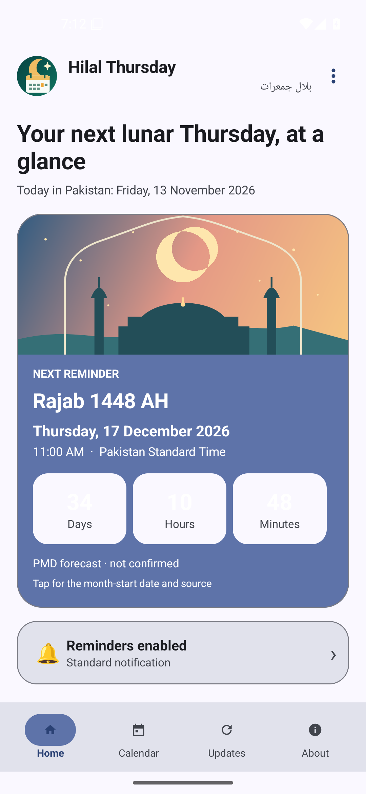
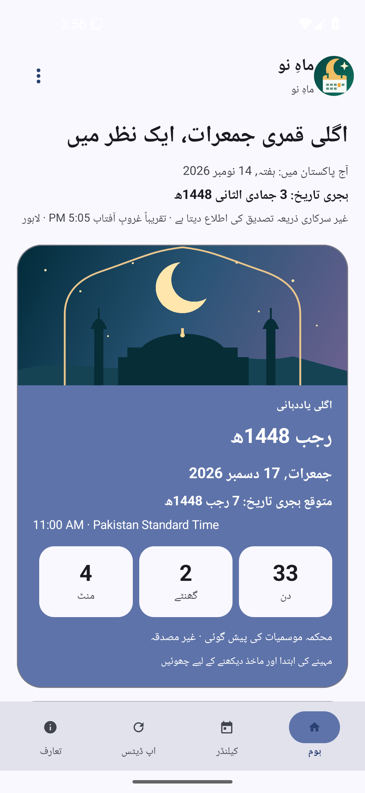
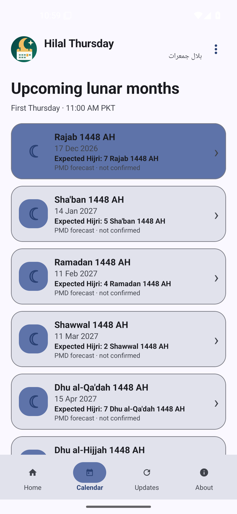
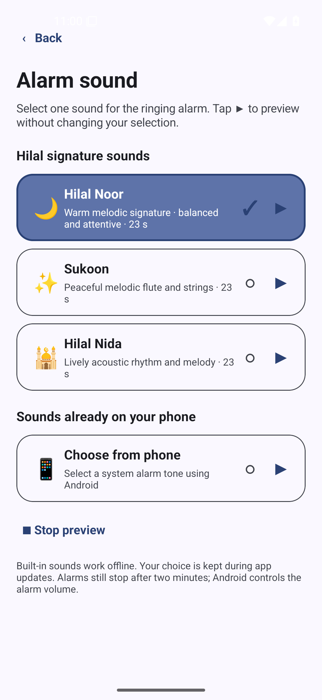
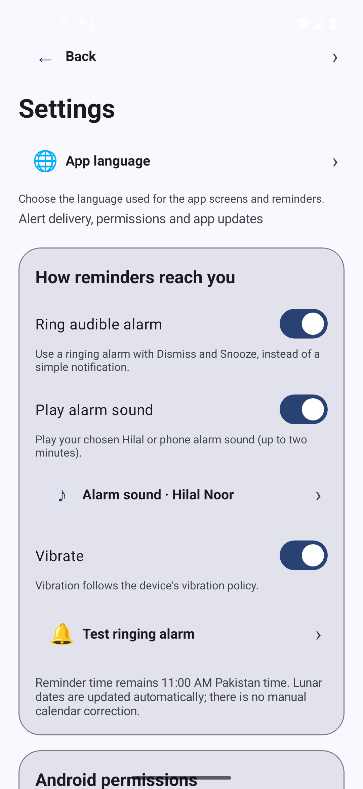
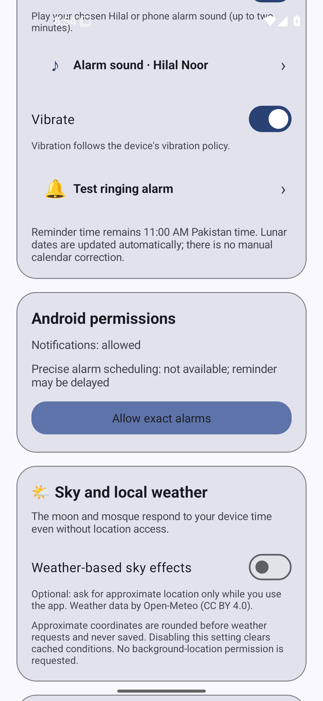
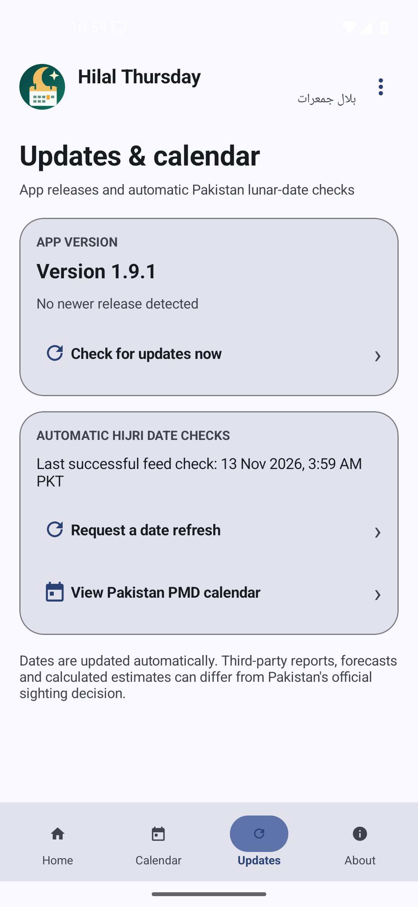
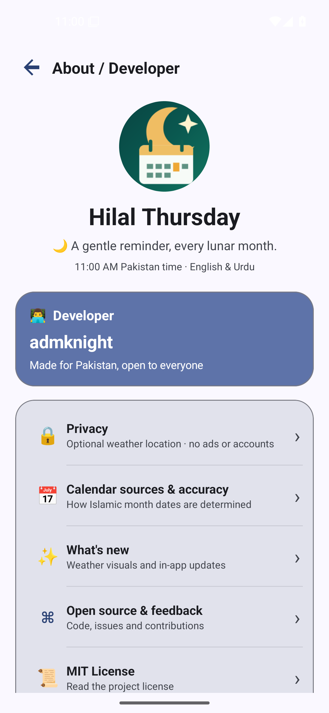
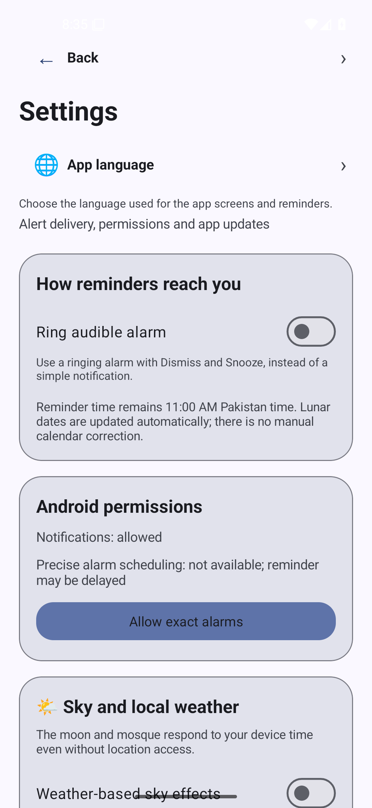

<div align="center">


<h1>Hilal Thursday · ہلال جمعرات</h1>

<p><strong>Pakistan's lunar-month Thursday reminder, made simple.</strong><br>
A bilingual, open-source Android app that reminds you on the first Thursday of each Islamic month at <strong>your selected Pakistan time</strong> (11:00 AM PKT by default).</p>

<p>
  <a href="https://github.com/admknight/pakistan-lunar-thursday/releases/latest"></a>
  <a href="https://github.com/admknight/pakistan-lunar-thursday/actions/workflows/build-apk.yml"></a>
  <a href="https://github.com/admknight/pakistan-lunar-thursday/releases"></a>
</p>

<p><a href="https://github.com/admknight/pakistan-lunar-thursday/releases/latest"><strong>⬇️ Get the latest signed APK</strong></a> &nbsp;·&nbsp; <a href="#real-app-screenshots"><strong>📱 Real screenshots</strong></a> &nbsp;·&nbsp; <a href="#signature-alarm-sounds"><strong>🎶 Alarm sounds</strong></a> &nbsp;·&nbsp; <a href="#important-accuracy-limitations"><strong>📅 Accuracy &amp; sources</strong></a></p>

<sub>Android 8.0+ · English / اردو · No accounts or ads · Originally published as Lunar Thursday</sub>

</div>

> **Date accuracy:** Today's Gregorian date is shown as a Pakistan civil date. **Today's Hijri Date** is displayed with a separate source-quality label and changes at **approximate local sunset** when a Pakistan city is selected or the existing optional weather location is available. Without a location, it explicitly falls back to a **civil-date estimate**. Future Gregorian/Hijri reminder dates remain provisional; forecasts and third-party reports are **not official Ruet-e-Hilal confirmation**.

## Real app screenshots

These are **genuine, unedited screenshots** of the permanently signed **v1.9.1** APK running on a **Pixel 5 / Android 15 emulator (API 35)**, captured with Android Debug Bridge. They are **not promotional mockups**. This version fixes the duplicate crescent and shows **Today's Hijri Date** with its source/accuracy status, while future month dates remain labeled **Expected Hijri**. Settings include a user-selectable reminder time and city-based approximate Maghrib boundary. Weather/location was disabled during capture; the Hijri home display therefore shows its documented civil-date fallback.

| Dashboard · English | Dashboard · اردو | Upcoming Islamic months |
|:---:|:---:|:---:|
|  |  |  |

| Signature alarm sound picker | Ringing alarm settings | Weather and location |
|:---:|:---:|:---:|
|  |  |  |

<details>
<summary>More screenshots — updates, About and general Settings</summary>

| Updates and date checks | About &amp; Developer | General settings |
|:---:|:---:|:---:|
|  |  |  |

</details>

The captures show the app's real Android UI, including its emulator permission state and the selected date source; dates are illustrative, **not official moon-sighting announcements**. UI colors, fonts and positioning can vary by device. See [the reproducible capture script](scripts/capture_readme_screenshots.sh) and [verified v1.9.1 emulator capture run](https://github.com/admknight/pakistan-lunar-thursday/actions/runs/43324644906).

## Download / install

**Recommended:** Get the [latest permanently signed Android APK](https://github.com/admknight/pakistan-lunar-thursday/releases/latest) from the normal GitHub release, then approve the installation in Android. This stable build uses the same long-lived certificate for in-place upgrades and includes a matching SHA-256 checksum. Android 8.0 or later is required.

Once installed, the **in-app updater** can check GitHub Releases, download newer compatible APKs directly inside the app, verify their package, digest and signing certificate, and hand them to Android's installer for approval. It never silently installs updates.

**Debug-signed previews are separate test builds.** They are publicly downloadable but may have changing signing keys. Moving from a debug preview to the stable signing identity requires uninstalling the preview (which can erase local settings). Android 13+ may ask for notification permission, and Android 12+ may require alarm scheduling permission for more exact reminders. No monthly date entry is required.

## Features

- A one-time automatically scheduled reminder at **11 AM Pakistan time** on the first Thursday of each new Islamic month.
- Automated date checks using HTTPS and Android `JobScheduler`, nominally every six hours and subject to Android background execution limits.
- Cache of dates the third-party provider explicitly labels as confirmed, never treating its estimates as confirmations.
- PMD published **2026–2027 forecast dates** used as fallback, then a clearly labeled *calculated approximation* for other years.
- Rescheduling on device reboot, clock or timezone changes, app update, and exact-alarm permission changes.
- Material 3 interface, light/dark theme, **Material You dynamic wallpaper color** on Android 12+.
- **English / اردو bilingual interface**, with a Settings language selector (device language / English / Urdu), Urdu calendar month labels, translated reminder text, and right-to-left layout. Android 13+ users can also change the app language in system settings.
- **Rebranded Hilal Thursday icon:** teal-and-gold crescent with a highlighted calendar day; adaptive icon for shaped launchers plus monochrome themed-icon variant on supported Android devices.
- **Optional ringing alarm** in Settings: choose from three original 23-second signature music cues (**Hilal Noor, Sukoon, Hilal Nida**) or an existing Android phone alarm sound. Includes preview/selection, optional vibration, **Dismiss**, **Snooze 10 minutes**, and a two-minute ringing limit. Notification-only mode remains available.
- **Settings page** with alarm preferences, exact-alarm/full-screen permission guidance, and automatic updates that require no manual lunar-date adjustments.
- **In-app update manager:** Checks the project's GitHub Releases API when the app opens, with optional daily background update notifications. Download progress and SHA-256 digest, Android package-ID, version, and signing-certificate verification all occur inside Hilal Thursday; **no browser or GitHub page is opened to update**. Android still controls and confirms APK installation, and may first request approval to install from this app. Installation is never silent. Stable builds exclude incompatible debug-signed previews.
- **Interactive home dashboard** with live countdown in Pakistan time, tap-to-explore upcoming month cards, a reminder status / alert-mode overview, and one-tap date refresh requests (queued through Android JobScheduler).
- **About / Developer page** for `admknight`, open-source attribution, privacy, calendar-source transparency, and small hidden easter eggs.
- Next reminder, upcoming months, source quality, last successful feed check, and a test-notification button.
- **No accounts, no ads, no tracking, and no manually entered lunar dates.** Optional location permission is used **only after the user enables weather visuals**; the app never requests background or precise location.

## Gregorian and expected Hijri dates

The Home and Calendar screens display **Gregorian dates alongside Hijri dates**. For future reminders, the app says **Expected Hijri**, since the actual month start may change. For example, the PMD forecast of Rajab 1448 starting on **11 December 2026** gives **Thursday, 17 December 2026 · expected 7 Rajab 1448 AH**. The home screen instead uses the neutral heading **Hijri Date** for today, and separately reports the provider's evidence status and whether the day is sunset-aware or a civil-date fallback.

The day and month come from the **same month-start observation/forecast/estimate used by the reminder engine**, so a newer source first day updates the displayed dates. For today's Hijri display, **Settings → Hijri date and Maghrib → Sunset location** lets users select a Pakistan city; the display changes at that city's **approximate astronomical sunset**. Automatic mode may reuse the already-permitted, optional weather location. Without a city or available location, the app clearly labels the result a **Pakistan civil-date estimate**. These calculated sunset times are not certified prayer times and do not establish an official moon sighting.

## Signature alarm sounds

Hilal Thursday includes three **music-derived, 23-second custom alarm cues** made from recordings supplied by the maintainer: **🌙 Hilal Noor** (the default), **✨ Sukoon**, and **🕌 Hilal Nida**. These are converted excerpts of the Gemini-generated musical recordings the maintainer reviewed; **they are not the rejected synthetic notification tones**.

Enable **Settings → Ring audible alarm** and choose **Alarm sound** to preview, select, and save one of the built-in sounds, or choose **📱 From phone** to open Android's existing alarm-tone picker. The app does **not** change the system-wide ringtone; selection persists between upgrades. Sounds play locally without requiring network access and obey the existing two-minute ringing limit, Dismiss and Snooze controls. Phone sounds that disappear or become inaccessible fall back to an available alarm.

**Audio rights and provenance:** [docs/AUDIO.md](docs/AUDIO.md). The MIT license for software should not be interpreted as a verified license grant for AI-generated sound recordings; check rights before independent redistribution or commercialization.

## Ringing alarm and updates

Open **Settings** to enable **Ring audible alarm** if a normal notification is easy to miss. You can toggle sound and vibration independently and test the alarm from Settings. Alarm sound/vibration stop automatically after two minutes even if you don't dismiss; Snooze schedules another attempt ten minutes later. Android notification, exact-alarm, foreground service, and (on some devices) full-screen intent permissions affect availability and timing. Do Not Disturb, battery restrictions, device power-off, and OEM behavior can suppress or delay ringing. This path has been built in CI, **not tested on a physical phone**.

The **update manager** checks the public GitHub Releases API when the app opens, at most every twelve hours after a successful check. An optional daily Android JobScheduler task can notify you about newer signed stable releases while the app is closed; Android may defer the check for battery/network reasons. A selected update is downloaded **inside the app**, with progress, maximum-size checks, GitHub release-asset SHA-256 digest verification, package identity, version upgrade, and matching installed APK signer verification. It then invokes Android's built-in installer to obtain explicit user approval. Android 8+ may require a one-time **Allow from this source** system permission. No GitHub browser or web page is involved in updating; no APK is silently installed. Debug preview builds cannot replace a permanently signed stable APK.

### Preview builds versus permanently signed public releases

CI preview builds are **debug signed** and available publicly for testing. The separate, certificate-verified release workflow has been operational since **v1.4.0** and publishes signed public releases with a consistent key. The secret signing material is not committed to GitHub; see [signing documentation](docs/SIGNING.md). A preview cannot be installed as an in-place update over a stable build with a different certificate, and migrating from preview to stable generally requires uninstalling the preview. Signed builds exclude incompatible debug previews from update recommendations. APK signing does not prove real-device reminder timing.


## Dashboard and navigation

The main screen now has a compact app header with a three-dot **More options** menu, a decorative crescent-and-mosque night-sky card, three live countdown tiles (days/hours/minutes), a small reminder-status row and the next upcoming months. A bottom navigation bar switches between **Home**, **Calendar** (upcoming Hijri months), **Updates** (release/date checks), and **About**. The design is built with native Android views and Material 3 dynamic colors; the previous promotional concept was not a screenshot and is not claimed to be reproduced pixel-for-pixel.

The **About / Developer** screen uses concise icon-and-text rows for privacy, calendar accuracy, recent releases, project feedback and the MIT license rather than full-width GitHub buttons. Three optional hidden interactions remain: tap the home logo/title seven times, long-press the About icon, and tap the About version area five times. None of the easter eggs changes alarms, dates, or update settings.

Android accessibility labels, English/Urdu strings, and right-to-left layouts are retained. The **first-Thursday rule remains automatic**, while users can choose any reminder time in Pakistan Standard Time under **Settings → Reminder time**; existing installations default to **11:00 AM PKT**. The UI has been captured on an Android emulator; exact delivery, notifications and ringing behavior on physical devices remain unverified.

## Living sky and optional local weather

The home illustration reacts to the device's current time of day (morning, daylight, sunset, night), **even offline and without location access**. In **Settings → Sky and local weather**, opt in to weather effects. Android will ask for **approximate location** while the app is in use. Hilal Thursday retrieves a one-time coarse location, rounds it to two decimal places, and retrieves current temperature, WMO weather code, and daylight status from Open-Meteo. Clouds, rain, fog, snow, and storms change only the decorative scene; **weather data is not a hazard alert or official lunar-sighting source**. No continuous GPS polling or background location access is used. Cached conditions expire after three hours, and weather refreshes are throttled to about 45 minutes. When permission, location, connectivity, or weather data is unavailable, the app falls back to the time-of-day sky.

Weather data attribution: [Open-Meteo](https://open-meteo.com/) · [CC BY 4.0](https://creativecommons.org/licenses/by/4.0/). Open-Meteo's free hosted endpoint is for non-commercial use; maintainers must review licensing before any commercialization.

## Bilingual app language and icon

Go to **Settings → App language** to choose **Follow device language**, **English**, or **اردو**. The language selection is retained locally on Android 8–12; on Android 13+ it uses Android's native per-app language system. Islamic month labels and on-screen dates follow the selected interface language. The selected reminder time is stored in **Pakistan Standard Time**, independent of the phone's locale/time zone. The default remains **11:00 AM PKT** until the user changes it.

The updated app icon uses native Android vector foreground/background layers and a separate monochrome layer for Material You themed icons. The published package name `com.scopewise.lunarthursday` and GitHub repository URL are intentionally unchanged to preserve upgrade compatibility, app data, and existing links. Branding is not a claim of government association or official sighting confirmation.

## Important accuracy limitations

A third-party data feed at `https://islamicdatetoday.pk/data/today.json` is used for estimated and explicitly reported-confirmed dates; it is **not** an official government announcement API. The authoritative moon-sighting decision in Pakistan is made by the Central Ruet-e-Hilal Committee. The feed previously returned a value of `pakistan_ruet_e_hilal_estimated`, which the app correctly does **not** treat as confirmation. There is no verified official machine-readable announcement API integrated into this project.

**Automatic operation does not mean guaranteed official accuracy.** If the feed is late, wrong, offline, or never reports a confirmation, the reminder will use a forecast/estimate; this may move the alert to the wrong Thursday. Android power management can defer a background refresh or notification, especially with permission restrictions, a switched-off device or force-stop. The UI always labels the calendar basis.

## Toolchain

- **Android Gradle Plugin:** 9.4.1 (stable)
- **Gradle:** 9.6.0
- **Material Components for Android:** 1.14.0 (Material 3)
- **Java:** 17
- **compileSdk:** 36; **targetSdk:** 35; **minSdk:** 26
- **Application ID:** `com.scopewise.lunarthursday`

The GitHub workflow installs the matching Android SDK platform/build tools, runs 206 portable Java assertions covering scheduling, feed policy, versioning, weather codes and alarm-tone selection, builds the APK and attaches its SHA-256 hash. It runs on pushes to `main`, pull requests and manual dispatch. Successful pushes to `main` also publish a **versioned GitHub pre-release** if that version has not already been published. Increment `versionName` when publishing a new preview; rebuilding the same version does not silently replace public assets. This project deliberately uses the stable Java Material Components SDK rather than introducing Kotlin/Compose into an already tested Java-only notification engine.

## Local build

Open the repository in recent Android Studio with JDK 17, or use Gradle 9.6.0 with Android SDK platform 36:

```bash
gradle --no-daemon :app:assembleDebug
```

The debug build appears at `app/build/outputs/apk/debug/app-debug.apk`.

Portable scheduling tests (no Android SDK required):

```bash
mkdir -p build/portable-tests
javac -d build/portable-tests \
  app/src/main/java/com/scopewise/lunarthursday/LunarEngine.java \
  app/src/main/java/com/scopewise/lunarthursday/FeedDatePolicy.java \
  app/src/main/java/com/scopewise/lunarthursday/VersionPolicy.java \
  app/src/main/java/com/scopewise/lunarthursday/WeatherCode.java \
  app/src/main/java/com/scopewise/lunarthursday/AlarmTonePolicy.java \
  test/java/com/scopewise/lunarthursday/EngineTest.java \
  test/java/com/scopewise/lunarthursday/FeedDatePolicyTest.java \
  test/java/com/scopewise/lunarthursday/VersionPolicyTest.java \
  test/java/com/scopewise/lunarthursday/WeatherCodeTest.java \
  test/java/com/scopewise/lunarthursday/AlarmTonePolicyTest.java
java -cp build/portable-tests com.scopewise.lunarthursday.EngineTest
java -cp build/portable-tests com.scopewise.lunarthursday.FeedDatePolicyTest
java -cp build/portable-tests com.scopewise.lunarthursday.VersionPolicyTest
java -cp build/portable-tests com.scopewise.lunarthursday.WeatherCodeTest
java -cp build/portable-tests com.scopewise.lunarthursday.AlarmTonePolicyTest
```

## Privacy

The app contacts the independent Hijri-date feed and GitHub's public Releases API, whose providers may observe the connecting IP address. **Weather visuals are strictly opt-in:** after enabling them, Android requests only approximate foreground location; coordinates are rounded to two decimal places (approximately 1 km) and sent by HTTPS to [Open-Meteo](https://open-meteo.com/). Raw location coordinates are not saved, and turning the feature off clears cached weather. No background or precise location permission is requested. Weather conditions are cached locally for up to three hours. Open-Meteo forecast data is supplied under [CC BY 4.0](https://creativecommons.org/licenses/by/4.0/) and its free-hosted API is intended for non-commercial use. The app sends no account credentials or tracking identifiers. Existing reminder settings and month-start observations remain local.

## Attribution / references

- [Pakistan Meteorological Department — lunar calendar](https://weather.gov.pk/cdpc/lunar-calendar)
- [PMD 2026 expected lunar starts](https://cdpc.pmd.gov.pk/probable2026.pdf)
- [PMD 2027 expected lunar starts](https://weather.gov.pk/storage/uploads/cdpc/lunar_calendar/pdf/probable%202027.pdf)
- [Third-party Pakistan Hijri-date feed](https://islamicdatetoday.pk/data/today.json)
- [Android notification alarm guidance](https://developer.android.com/develop/background-work/services/alarms)
- [Material 3 dynamic color](https://developer.android.com/develop/ui/views/theming/dynamic-colors)
- [Android Gradle Plugin compatibility](https://developer.android.com/build/releases/about-agp)

## License

The application source code is MIT-licensed; see [LICENSE](LICENSE). The externally generated musical recordings have separate [provenance and reuse notes](docs/AUDIO.md) and are **not assumed to be covered by MIT**.

**Build evidence:** Pure-Java tests and static XML checks can be run without Android SDK. Successful GitHub CI builds establish APK compilation, not real-device notification timing or official announcement accuracy.
